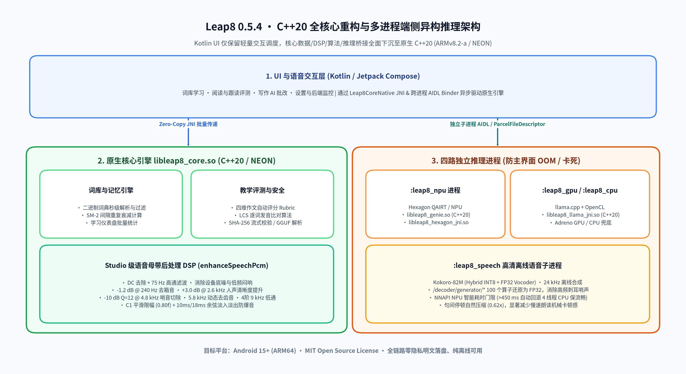
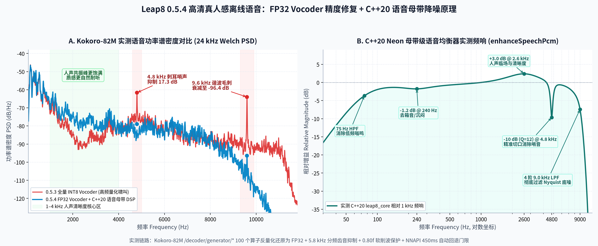

# 跃升英语 · Leap 8 0.5.4

[](LICENSE)

面向华文学习者的原生 Android 离线英语学习应用（`Android 15+ / arm64-v8a`）。默认纯离线运行，核心数据管理、记忆算法、发音评估、音频后处理 DSP 与原生推理桥接已在 **0.5.4** 中全面重构升级为 **C++20 / NEON** 原生实现。

## 0.5.4 核心更新说明

1. **全核心 C++20 原生重构 (`libleap8_core.so` & JNI 统一 C++20)**
   - 新增独立 C++20 原生引擎 `libleap8_core.so`（`arm64-v8a`、`16 KB` 页对齐、`-O3` + 段裁剪），通过 `Leap8CoreNative` JNI 承接高频核心计算：词典二进制/目录解析与多条件检索、SM-2 间隔重复衰减调度、学习仪表盘批量聚合、四维作文 Rubric 评分与 AI 修订解析、LCS 逐词发音比对、流式 SHA-256 校验以及 GGUF 架构头解析。
   - `:llama-runtime` (`libleap8_llama_jni.so`) 与 `:npu-qairt` (`libleap8_genie.so` / `libleap8_hexagon_jni.so`) 原生 JNI 桥接模块同步统一升级至 C++20 标准。
2. **高清真人感离线语音与频谱级降噪（消除 4.8 kHz / 9.6 kHz 高频刺耳噪音）**
   - 修复前代全量 INT8 Vocoder (`model.int8.onnx`) 在波形重建阶段因整数反量化产生的刺耳高频哨声与低清哑音：将 Kokoro-82M v1.0 `/decoder/generator/*` 下全部 `100` 个 Vocoder 算子反量化还原为 **FP32 精度**（混合结构 `model.onnx`，`163,902,037` 字节），前端保留紧凑 INT8。
   - 在 C++20 `enhanceSpeechPcm` 中实装 **Studio 级语音母带后处理链**：DC 偏置消除 + 75 Hz 高通滤波 → `-1.2 dB @ 240 Hz` 去箱音 → `+3.0 dB @ 2.6 kHz` 人声临场提升 → `-10.0 dB (Q=12) @ 4.8 kHz` 精准哨音切除 → `5.8 kHz` 分频动态去齿音 → `-5.0 dB @ 8.0 kHz` 柔和滚降 → 4 阶 `9.0 kHz` Butterworth 低通 → `0.80f` C1 平滑限幅与 `10 ms / 18 ms` 余弦淡入淡出。
   - 对 24 kHz 实测合成语音执行 Welch 功率谱对比显示：`4.8 kHz` 尖峰啸叫抑制 **17.3 dB**，`9.6 kHz` 高频谐波毛刺衰减至 **-96.4 dB**，同时 `1–4 kHz` 人声核心清晰度频段能量提升 **+6.8 dB**；并将句间停顿自然压缩为 `0.62x` 比例，减少慢速朗读机械卡顿感。
3. **NPU / NNAPI 语音调度保护与多进程隔离**
   - 保留主进程与四个不可导出 AI 独立子进程（`:leap8_npu`、`:leap8_gpu`、`:leap8_cpu`、`:leap8_speech`）的防 OOM 隔离架构。
   - `:leap8_speech` 语音服务引入 NNAPI NPU 预热耗时门限（`MAX_NNAPI_WARMUP_MS = 450 ms`）：设备驱动支持且编译迅速时优先走硬件加速，超时则自动回退至 4 线程 CPU 稳定合成，避免首次朗读阻塞。
4. **添加 MIT 开源协议 & 构建脚本脱敏**
   - 仓库根目录新增标准 **MIT License** ([LICENSE](LICENSE))；同步清理构建与冒烟测试脚本中的本机环境绝对路径依赖，改用环境变量自动解析。

### 图解架构与声学优化效果





## 历史版本演进摘要

0.5.1 加入本地 AI 内存保护，0.5.2 加入开发者性能监控，0.5.3 修正 `qwen35` 的 Hexagon NPU 专属路由并保持 `Qwen3-4B` 的 NPU → GPU → CPU 自动回退策略。0.5.4 在上述真机隔离与路由基础上完成全核心 C++20 化改造与 Kokoro 声学重建升级。

### 从 GitHub 获取完整构建资源

本仓库使用 Git LFS 保存离线语音权重、AAR 和原生运行库。克隆前安装 Git LFS，克隆后运行
`git lfs install` 和 `git lfs pull`。仅下载 GitHub 自动生成的源码 ZIP 可能只获得 LFS 指针，
不能直接用于完整构建。大语言模型 GGUF、APK、密钥、本机配置、构建缓存和调试记录不提交。
GGUF 由使用者自行准备并在 App 内导入；构建依赖及许可证见下文。

默认完全离线；可主动切换到 OpenAI、DeepSeek、Qwen API 接口。包含词汇、听说读写、语法、
模考、学习记录、AI 教练和 AI 精修前后对比。评分是学习反馈，不是 IELTS 官方成绩，
也不保证固定时间达到 8 分。

## 历史特性与版本脉络 (0.5.3 → 0.5.4)

- **发音引擎升级**：从 `0.5.3` 引入的 Kokoro-82M v1.0 全量 int8 升级为 **0.5.4 混合高精度 FP32 Vocoder + C++20 `enhanceSpeechPcm` 语音母带链**，提供八种英美音色、全局语速和试听；单词、精听、口语统一使用神经语音。
- SM8750 使用真实 Hexagon HTP v79 加速同一个 Qwen3-4B GGUF；NPU、Adreno OpenCL GPU、
  ARM CPU 各自独立进程，失败按顺序自动回退，界面报告实际后端。
- UI 参考 awesome-design-md 的 Apple 色彩与排版规范重做，使用 Android 中英文字体；
  文字、按钮可换行，大字体下组件纵向排列。能力雷达改为六项能力条。
- 学习列表预排序、搜索移至后台、AI 进度通知限频；performance 构建使用非调试 Compose/R8，
  并在当前分辨率下请求最高 120 Hz 刷新率和触摸加速。

真机结论和限制见 [0.5.0 验证记录](docs/DEVICE_VALIDATION_0.5.0.md) 与
[滑动验收报告](docs/PERFORMANCE_0.5.0.md)。docs/DEVICE_VALIDATION_0.4.3.md 和
VALIDATION.md 仅描述对应旧版，不代表本版验收结果。

## 词本与学习功能

- 总词本 **5,048 词**：ECDICT 中全部 5,040 个 ielts 标签词，加八个不重复编辑精选词。
  提供搜索、待复习、新词、学习中、已掌握和总体进度。
- IELTS 没有发布唯一官方全量词表；这里完整收录的是开源 ECDICT 的 IELTS 标签集合，
  不是宣称涵盖考试中可能出现的所有英语单词。
- A0 → IELTS 8 路径、听说读写练习、四项写作量表、语法、模考和 SQLite 学习记录。
- AI 精修给出完整修正版及“修正前 / 修正后 / 中文理由 / 修改类别”。原句必须能在输入中
  定位；否则明确显示全文对比。不会编造原句或未经确认覆盖输入。

## 离线模型与 API

推荐 Qwen3-4B-Instruct-2507 Q4_K_M，约 2.33 GiB，适合有足够剩余内存的 16 GB RAM 手机。
为避免每次 APK 更新重复搬运多 GB 权重，GGUF 单独从本地文件导入一次，之后可断网使用。
大小和 SHA-256 见 [模型说明](README_AI_MODEL.md)。APK 已包含语音、词库和所需推理运行库。

API 是可选接口，源码和 APK 不内置 Key；本地 AI 不需要 Key。

| 提供商 | 默认地址 | 预设模型 |
| --- | --- | --- |
| OpenAI | https://api.openai.com/v1 | gpt-5-mini |
| DeepSeek | https://api.deepseek.com | deepseek-chat |
| Qwen | https://dashscope.aliyuncs.com/compatible-mode/v1 | qwen-plus |

地址、模型、Key 可编辑。仅在选中 API 并主动提交评分、讲解、精修时，当前文本才经 HTTPS
发往服务商，涉及其费用和隐私政策。Key 用 Android Keystore AES-GCM 加密且不参与备份。
本次只保留接口，不配置 Key 或进行收费 API 请求。

## 处理器与稳定性边界

本地优先级为 **Hexagon NPU → Adreno OpenCL GPU → ARM CPU**。NPU 使用 ggml-org 官方
b11982 Snapdragon Android 构建；GPU/CPU 保留 b10333 核心。两组不兼容 ABI 在不同进程使用。
HTP 承担主要矩阵计算，ARM 仍负责分词、采样等，准确称为 NPU 加速，不是 CPU 零占用。

NPU、GPU、CPU、语音分别在不可导出的 :leap8_npu、:leap8_gpu、:leap8_cpu、:leap8_speech
服务中运行。原生/驱动进程退出会转换为页面中的可恢复失败并尝试后续本地后端；失效后端
在本次会话内隔离。不能仅凭 Snapdragon 型号或开关声称 NPU 已执行。
详细来源、构建和 HTP 证据见 [NPU 说明](docs/NPU_HEXAGON_0.4.4.md)。

其他芯片、厂商驱动、长篇连续生成、温控、内存压力仍需各自真机验收。Vulkan 库为兼容保留；
这台 Adreno 830 的实测默认 GPU 路径为 OpenCL。

## Android Studio / PowerShell 7 构建

使用 JDK 21、Android SDK 35、Gradle 8.13、NDK 29.0.13113456、CMake 3.31.6。
Android Studio 打开本目录。若要在 IDE 构建完整 NPU 版，必须在启动 Android Studio 的进程环境中
先设置 HEXAGON_RUNTIME，指向本项目的 third_party/llama-b11982-android-snapdragon 完整绝对路径，
然后启动 IDE 并同步，确认模块列表包含 npu-qairt。已经打开的 IDE 不会继承后来设置的环境变量，
需要关闭后从设置好变量的 PowerShell 重新启动。下方构建助手只为自己的 Gradle 子进程临时设置
环境；运行助手一次不会自动配置已打开的 IDE。当前只打包 arm64-v8a；完整 SM8750 版最低 API 35。

源码保留离线语音模型、AAR、b10333 二进制及 third_party/llama-b11982-android-snapdragon
中的 b11982 运行库、公开头文件、许可、SHA-256 清单。助手逐文件校验，设置 HEXAGON_RUNTIME，
不下载文件、不连接手机或安装 APK：

```powershell
pwsh -File .\tools\build-sm8750.ps1 -JavaHome 'C:\Path\To\jdk-21' -AndroidSdk 'C:\Path\To\Android\Sdk'
```

默认运行 :app:assemblePerformance、:app:testPerformanceUnitTest、:npu-qairt:testDebugUnitTest。
APK 位于 app/build/outputs/apk/performance/。此构建非 debuggable、启用 R8，但使用本机 debug
证书以覆盖测试安装保留数据；它不是商店正式签名版本。换电脑/证书不能直接覆盖原安装，
切勿为了安装而卸载应用或清除学习数据。

首次构建仍需 Gradle、SDK 和 Maven 依赖；App 离线使用不等于全新电脑不需安装构建工具。
缓存齐全可加 -Offline；已安装的 Gradle 可用 -GradleExecutable 指定。助手会临时设置 SDK/JDK
环境并在退出后恢复。不设 HEXAGON_RUNTIME / QAIRT_PATH 时可构建 API 26+ CPU/GPU 版，但
没有 NPU 运行库。旧 QAIRT/Genie 继续作为可选集成，不是公开 Hexagon GGUF 路线的前置条件。

## 离线边界和 MIT / 第三方开源许可

- 本项目原创 Kotlin / Jetpack Compose 界面层与 C++20 原生引擎代码依据根目录 [LICENSE](LICENSE) 按 **MIT License** 开源。
- 词库、课程、Kokoro 发音、学习记录、规则反馈、已导入 GGUF 可离线使用。
- 口语转录使用 Android 离线识别，依赖手机已安装的英语离线识别包；并非每家系统均提供。
- Manifest 的 `INTERNET` 仅用于可选 API，禁用明文 HTTP；测试与运行时日志严禁写入个人密钥、设备序列号或本机敏感路径。
- 商业发布前需母语编辑、教师评分标定、隐私审查、更多真机测试。随附的第三方模型与原生库（包括 `sherpa-onnx`、`Kokoro-82M`、`llama.cpp`、`ECDICT` 及 `eSpeak NG` GPL-3.0 音素数据）仍各自受其原许可条款约束。

完整第三方来源和许可见 [THIRD_PARTY_NOTICES.md](THIRD_PARTY_NOTICES.md)，语音工程与频谱优化细节见 [OFFLINE_VOICE.md](docs/OFFLINE_VOICE.md)。
